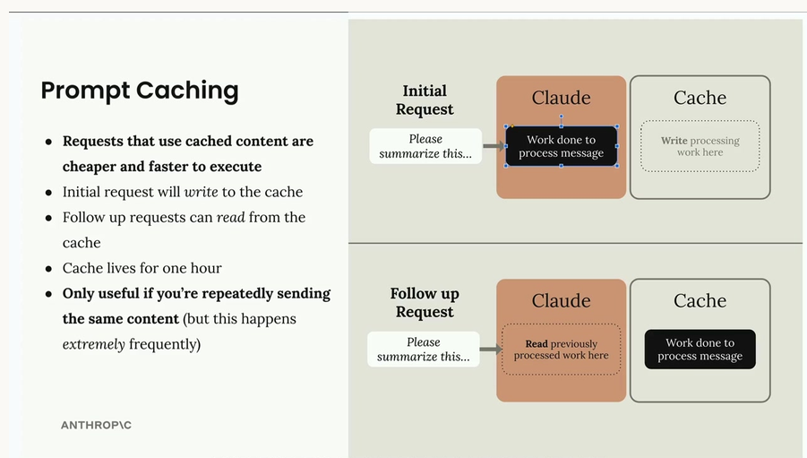
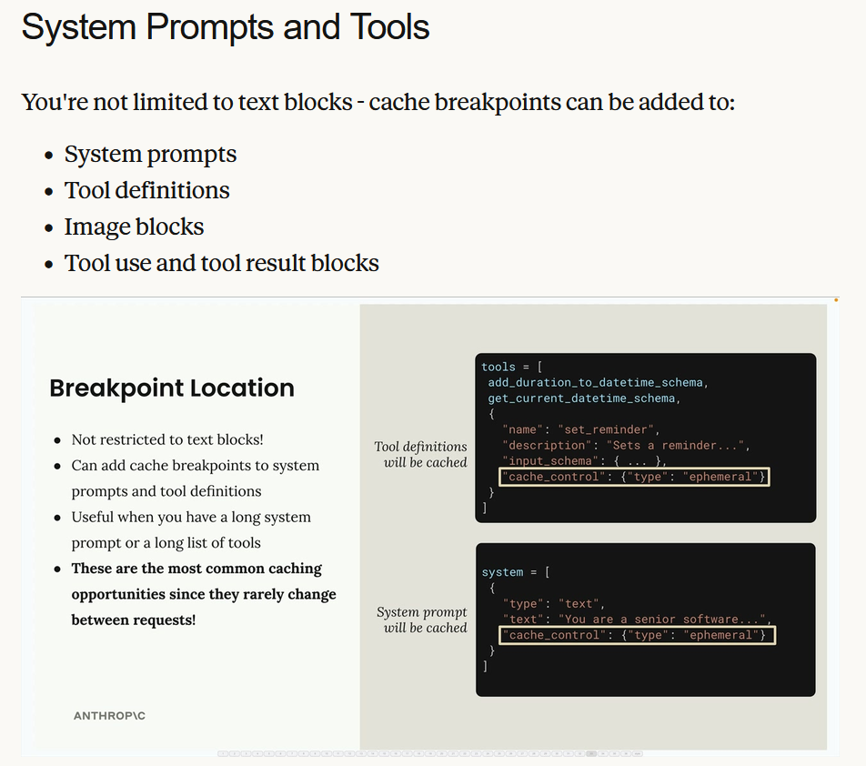
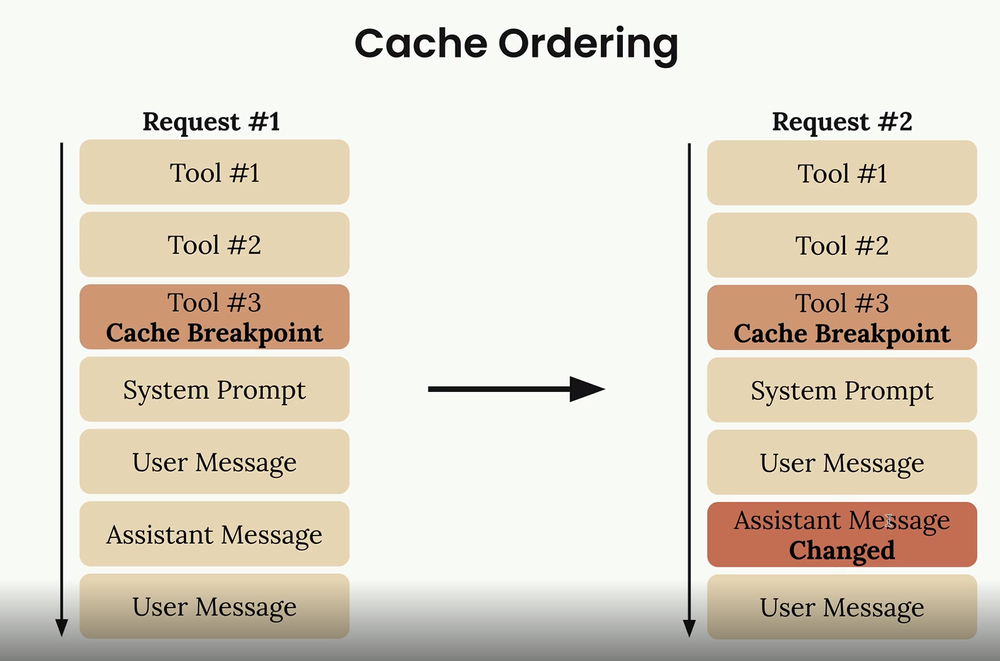

# Three different Graders for Prompt Eval
1. Code
2. Model
3. Human 

# Prompt Engineering

There are different Prompt Engineering Techniques
1. By adding XML tag
2. Providing examples in your prompts is one of the most effective prompt engineering techniques you'll use. This approach, known as "one-shot" or "multi-shot" prompting, involves giving Claude sample input/output pairs to guide its responses.

# Tools 
1. There are different blocks in response
    1. Text Block
    2. Tool Block
2. Fine Grained tool Calling - This works as a Stream function in API call. 
3. Text editor Tool - # Need to further Understand this concept (High Level Okay)
4. Web Search Tool - # Need to further Understand this concept (High Level Okay)

# Features of Claude
1. Extended Thinking - Can be enabled through parameters(thinking=False, thinking_budget=1024)
2. Image Support - Encrypt the image and follow the below structure
    [
    # Image Block
    {
        "type": "image",
        "source": {
            "type": "base64",
            "media_type": "image/png",
            "data": image_bytes,
        }
    },
    # Text Block
    {
        "type": "text",
        "text": "What do you see in this image?"
    }
    ]
3. Pdf/Document Support - Similar like Image but type need to change
4. Citation -Turn Citation Features On
    [
    # Image Block
    {
        "type": "document",
        "source": {
            "type": "base64",
            "media_type": "application/pdf",
            "data": file_bytes,
        },
        "title":"earth.pdf",
        "citations":{"enabled":True}
    },
    # Text Block
    {
        "type": "text",
        "text": "How earth is formed"
    }
    ]
5. Prompt Caching
    1. Prompt caching in Claude works by storing the computational work done on your messages so it can be reused in follow-up requests. This makes subsequent requests both faster and cheaper to execute, but only when you're repeatedly sending identical content.
    
    

    We can also use it in System Prompts and Tools. THis is more appropriate place to perform Caching since this will not change more often

    

6. Rules of Caching
    1. Cache Ordering
        1. Exactly claude follows the below ordering for cache in case if you declare the break point at Tool#3 them all the other following work will be processed as new
        2. We can aslo have multiple breakpoints - Example as shown in right side of the image. #1 at Tool3, #2 at Assistant Message
        
    

    2. To enable cache we need atleast 1024 tokens of text otherwise even if you enable the cache it will not work

7. Code Execution and Files API
    1. 