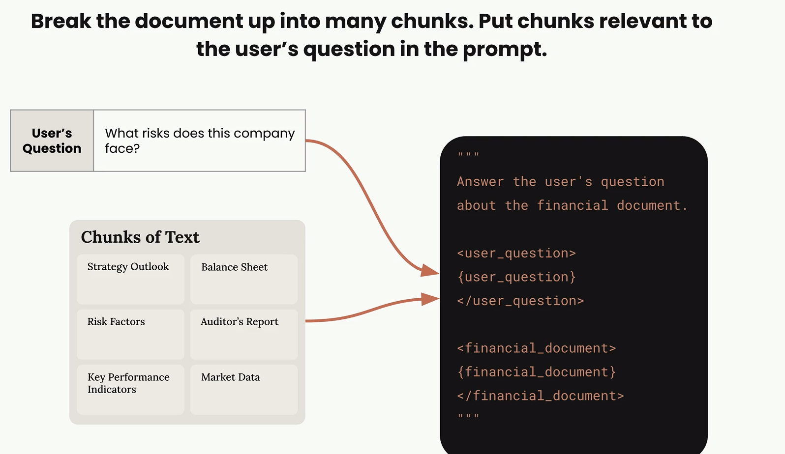
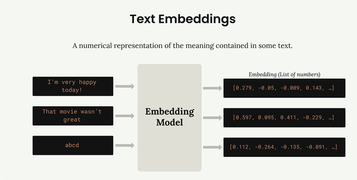
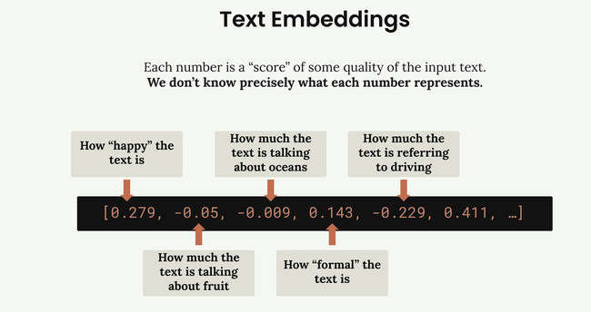

# Typical RAG Flow

# Chunking Strategies
<h2> Size Based </h2>
    <h3> Technique: Divide the text into strings of equal length </h3>
    
 1. Incude overlap on each side of the chunk to include some context 

    
 2. Easy to implement but break up related content int sperate chunks 

<h2> Structure Based </h2>
    <h3> Technique: Divide the text based upon on the structure (headers, paragraph, sections) </h3>
    
 1. Avoids breaking up multiple content into multiple chunks 
 
    
 2. Requires us to understand the structure of document beforehand 
 
<h2> Semantic Based </h2>
    <h3> Technique: Divide text into groups of related sentences or sections </h3>
    
 1. Required us to understand the meaning of invidual sentences 
 
    
 2. Computationally expensive but more relevant chunks 
 

# Text Embeddings

